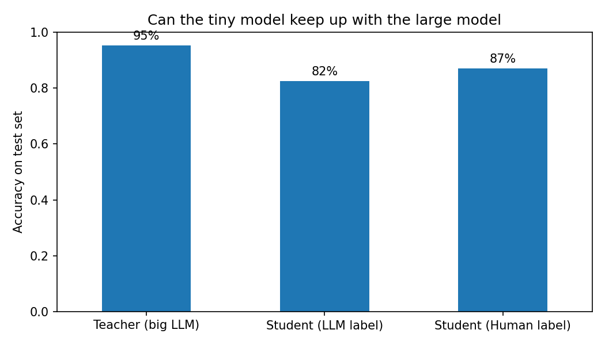

# Distilling an LLM into a tiny finance sentiment model

Using Claude as a "teacher" to label 600 financial news sentences, then trained a
small model (MiniLM embeddings + logistic regression) only on those labels.

## Results (400 sentences, human labels as truth)

| Model | Accuracy | F1 | ms / sentence |
| --- | --- | --- | --- |
| Teacher (Claude Haiku) | 0.952 | 0.944 | 912.925 |
| Student (LLM labels) | 0.825 | 0.829 | 1.601 |
| Student (human labels) | 0.870 | 0.871 | 1.601 |

## Takeaway
The student reached roughly 82% of the teacher's accuracy while running 500x faster, at
basically zero cost per prediction.

## Stack
Python, Anthropic API, sentence-transformers, scikit-learn, Gradio

Data: Financial PhraseBank (Malo et al., 2014), non-commercial license.
